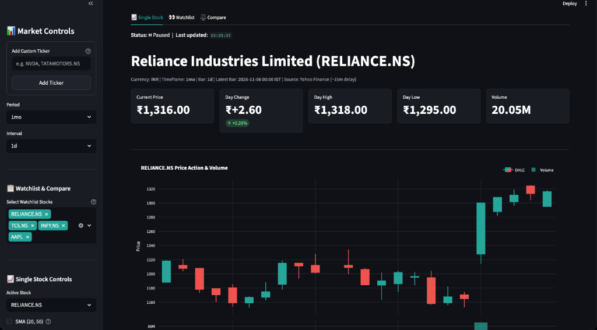

# 📈 Real-Time Stock Market Dashboard

A high-performance, real-time stock market tracking and analytics dashboard built with **Python**, **Streamlit**, and **Plotly**. Features live financial charts, institutional-grade technical indicators implemented from scratch in pure **Pandas & NumPy** (zero third-party technical analysis libraries), a multi-asset watchlist with live sparklines, and a risk/return equity comparison suite.

[](https://share.streamlit.io/professorofai/Stock-Market-/main/app.py)
[](https://www.python.org/downloads/)
[](https://opensource.org/licenses/MIT)
[](https://docs.pytest.org/)

---

## 📸 Dashboard Showcase



### Recommended Showcase Captures
To build a complete portfolio presentation, add the following captures to the `screenshots/` directory:
1. **`screenshots/single_stock_overview.png`** *(Included)*: Single-stock view showing live KPI metric cards, market status indicator, and candlestick volume chart.
2. **`screenshots/watchlist_tab.png`**: Multi-stock watchlist with tabular overview, colored day-change percentages, and dynamic price sparkline trends (`st.column_config.LineChartColumn`).
3. **`screenshots/compare_tab.png`**: Normalized performance comparison (rebased to 100), daily returns correlation heatmap, and quantitative risk/return metric table.
4. **`screenshots/indicators_overlay.png`**: Detailed candlestick view with Bollinger Bands, VWAP, and sub-panels for RSI (with overbought/oversold bands) and MACD (with momentum histogram).
5. **`screenshots/live_autorefresh.gif`**: Short GIF demonstrating flicker-free live background updates via `st.fragment`.

---

## 🚀 Features

### 1. Live Market Data & Real-Time Tracking
- **Multi-Exchange Ticker Support**: Supports global tickers across US exchanges (NASDAQ, NYSE like `AAPL`, `MSFT`, `NVDA`) and Indian exchanges (NSE, BSE like `RELIANCE.NS`, `TCS.NS`, `INFY.NS`).
- **Interactive Timeframes & Intervals**: Selectable periods (`1d`, `5d`, `1mo`, `3mo`, `6mo`, `1y`, `2y`) dynamically paired with valid intervals (`1m`, `5m`, `15m`, `30m`, `1h`, `1d`).
- **Live KPI Metric Cards**: Real-time display of Current Price, Day Change (absolute & percentage with directional delta colors), Day High, Day Low, and Volume.
- **Flicker-Free Auto-Refresh**: Powered by Streamlit's native `@st.fragment(run_every=...)`, enabling scheduled background polling without resetting sidebar widgets or re-rendering the whole page.
- **Market State & Stall Detection**: Detects market-closed states and weekend trading halts (`🟢 Live`, `⏸ Paused`, `🔴 Market closed`), pausing polling to conserve resources.
- **Interactive Plotly Visualizations**: Candlestick chart with volume subplots, dark-mode styling, and rangebreak gap removal to hide weekend and non-trading hours.
- **Export Capabilities**:
  - One-click CSV export containing cleaned OHLCV data and all computed technical indicators.
  - Standalone interactive HTML chart export utilizing Plotly CDN.
  - CSV export for comparative risk and return metrics.

### 2. Pure Hand-Coded Technical Indicators (Zero 3rd-Party TA Dependencies)
All indicators are implemented manually using vectorized Pandas and NumPy operations without external libraries like `ta` or `pandas-ta`:
- **Simple Moving Average (SMA 20 & 50)**: Trend smoothing across short and medium-term horizons.
- **Exponential Moving Average (EMA 12 & 26)**: Exponentially weighted price discovery.
- **Bollinger Bands (20-day SMA $\pm 2\sigma$)**: Upper, middle, and lower bands with shaded volatility envelopes.
- **Volume Weighted Average Price (VWAP)**: Institutional benchmark tracking dollar volume over total volume; automatically resets daily on intraday bars.
- **Relative Strength Index (RSI 14)**: Momentum oscillator utilizing J. Welles Wilder's exponential smoothing, bounded from 0 to 100 with overbought (70) and oversold (30) trigger levels.
- **Moving Average Convergence Divergence (MACD 12, 26, 9)**: Trend-following momentum indicator with MACD line, 9-day signal line, and color-coded momentum histogram.
- **Automated Indicator Summary Matrix**: Generates plain-English interpretive signals (e.g. Bullish Trend, Overbought, Bearish Crossover) based on latest readings.

### 3. Multi-Stock Portfolio Analysis & Comparative Intelligence
- **Interactive Watchlist**: Real-time comparative monitoring table featuring embedded price sparklines via `st.column_config.LineChartColumn`.
- **Normalized Performance Charting**: Rebased to a common baseline of 100 to compare multi-stock performance over time regardless of differing nominal share prices.
- **Cross-Market Calendar Alignment**: Intelligently harmonizes trading calendars across different international exchanges (e.g., US market holidays vs. Indian market holidays) via forward-fill date alignment.
- **Daily Returns Correlation Heatmap**: Diverging annotated matrix (`go.Heatmap`) analyzing cross-asset correlation from -1.0 to +1.0.
- **Quantitative Risk & Return Analytics**: Computes Total Return %, Annualized Volatility, Maximum Peak-to-Trough Drawdown %, and Sharpe Ratio (relative to a configurable risk-free rate).

---

## 🛠️ Tech Stack

| Technology | Purpose |
| :--- | :--- |
| **Python 3.10+** | Core programming language (tested up to Python 3.14) |
| **Streamlit (>= 1.37.0)** | Reactive frontend, `@st.fragment` partial reruns, and metric layouts |
| **Pandas & NumPy** | Vectorized financial arithmetic, OHLCV resampling, and indicator math |
| **Plotly (>= 5.18.0)** | High-performance interactive candlestick subplots and correlation heatmaps |
| **yfinance** | Market data extraction with exponential backoff and retry architecture |
| **Requests** | Network communication and header handling |
| **Pytest (>= 8.0.0)** | Comprehensive unit test suite with synthetic datasets |

---

## 🏗️ Architecture & Data Flow

The project follows a strict separation of concerns: `app.py` acts strictly as the presentation layer and never executes API calls or indicator math directly.

```
┌─────────────────────────────────────────────────────────────┐
│                    External APIs                            │
│                 (Yahoo Finance via yfinance)                │
└──────────────────────────────┬──────────────────────────────┘
                               │
                               ▼
┌─────────────────────────────────────────────────────────────┐
│                   data/fetcher.py                           │
│  - 3-Attempt exponential retry logic                        │
│  - Streamlit cache layer (@st.cache_data)                   │
│  - Ticker validation & fast_info quote retrieval            │
│  - Custom DataFetchError exception handling                 │
└──────────────────────────────┬──────────────────────────────┘
                               │
                               ▼
┌─────────────────────────────────────────────────────────────┐
│                  data/processor.py                          │
│  - Timestamp deduplication & monotonic sorting              │
│  - OHLCV resampling & daily return calculations             │
│  - Multi-market calendar alignment                          │
│  - Risk analytics (Drawdown, Volatility, Sharpe Ratio)      │
└──────────────────────────────┬──────────────────────────────┘
                               │
                               ▼
┌─────────────────────────────────────────────────────────────┐
│               indicators/technical.py                       │
│  - Pure vectorized functions (SMA, EMA, RSI, MACD, BB, VWAP)│
│  - Wilder's exponential smoothing                           │
│  - Daily intraday resetting VWAP                            │
│  - Summary indicator interpretation matrix                  │
└──────────────────────────────┬──────────────────────────────┘
                               │
                               ▼
┌─────────────────────────────────────────────────────────────┐
│                   charts/plots.py                           │
│  - Plotly subplots (Candlestick + Volume)                   │
│  - Rangebreaks (removes non-trading hours and weekends)     │
│  - Indicator overlays (Bands, VWAP, Moving Averages)        │
│  - Sub-charts for RSI and MACD                              │
│  - Normalized performance chart & Correlation heatmap       │
└──────────────────────────────┬──────────────────────────────┘
                               │
                               ▼
┌─────────────────────────────────────────────────────────────┐
│                        app.py                               │
│  - Streamlit UI entry point (Tab navigation & Sidebars)     │
│  - Live partial auto-refresh (@st.fragment)                 │
│  - Metric cards, interactive downloads & styling            │
└─────────────────────────────────────────────────────────────┘
```

---

## 📐 Indicator Methodology & Formulas

| Indicator | Mathematical Formula | Brief Explanation |
| :--- | :--- | :--- |
| **SMA** | $\text{SMA}_k = \frac{1}{k} \sum_{i=0}^{k-1} P_{t-i}$ | Unweighted arithmetic mean over $k$ periods to smooth price action. |
| **EMA** | $\text{EMA}_t = \alpha P_t + (1 - \alpha) \text{EMA}_{t-1}, \; \alpha = \frac{2}{\text{span} + 1}$ | Applies exponential weighting to recent bars to reduce lag. |
| **Bollinger Bands** | $\text{Upper/Lower} = \text{SMA}_{20} \pm (2 \times \sigma_{20})$ | Volatility envelope around a 20-day SMA; expands during high volatility. |
| **VWAP** | $\text{VWAP} = \frac{\sum (P_{\text{typical}} \times V)}{\sum V}, \; P_{\text{typical}} = \frac{H+L+C}{3}$ | Volume-weighted benchmark that automatically resets at the open of each intraday session. |
| **RSI** | $\text{RSI} = 100 - \left( \frac{100}{1 + \text{RS}} \right), \; \text{RS} = \frac{\text{WilderEMA}(\text{Gain}, 14)}{\text{WilderEMA}(\text{Loss}, 14)}$ | Momentum oscillator measuring internal price velocity; values above 70 indicate overbought conditions, below 30 oversold. |
| **MACD** | $\text{MACD} = \text{EMA}_{12} - \text{EMA}_{26}, \; \text{Signal} = \text{EMA}_9(\text{MACD})$ | Momentum and trend-following oscillator with a signal line and divergence histogram ($\text{MACD} - \text{Signal}$). |

---

## 💻 Local Installation & Setup

### Prerequisites
- Python 3.10, 3.11, 3.12, 3.13, or 3.14
- Git

### 1. Clone the Repository
```bash
git clone https://github.com/professorofai/Stock-Market-.git
cd Stock-Market-
```

### 2. Set Up Virtual Environment

#### On macOS / Linux:
```bash
python3 -m venv .venv
source .venv/bin/activate
```

#### On Windows (Command Prompt / PowerShell):
```cmd
python -m venv .venv
.venv\Scripts\activate
```

### 3. Install Dependencies
```bash
pip install --upgrade pip
pip install -r requirements.txt
```

### 4. Run the Unit Test Suite
Verify that all 22 technical indicator and data processing unit tests pass:
```bash
pytest stock-dashboard/tests/ -v
```

### 5. Launch the Streamlit Dashboard
Launch directly from the repository root:
```bash
streamlit run app.py
```
Or run from within the `stock-dashboard` package:
```bash
cd stock-dashboard
streamlit run app.py
```
Open [http://localhost:8501](http://localhost:8501) in your browser.

---

## ☁️ Deploying on Streamlit Community Cloud

Follow these steps to deploy this dashboard live on Streamlit Community Cloud for free:

1. **Fork or Push to GitHub**:
   Ensure your latest code is committed and pushed to your GitHub repository:
   ```bash
   git add .
   git commit -m "Deploy: Prepare production release"
   git push origin main
   ```

2. **Access Streamlit Cloud**:
   Navigate to [share.streamlit.io](https://share.streamlit.io) and sign in with your GitHub account.

3. **Deploy New App**:
   - Click the **"New app"** button.
   - **Repository**: Select `your-username/Stock-Market-` (e.g. `professorofai/Stock-Market-`).
   - **Branch**: Set to `main`.
   - **Main file path**: Set to `app.py`.
   - **App URL**: Choose a custom subdomain (e.g., `realtime-stock-dashboard.streamlit.app`).

4. **Advanced Settings (Optional)**:
   - Python version: Select Python `3.10`, `3.11`, or `3.12`.
   - No API secrets are required since the application fetches public data.

5. **Click "Deploy!"**:
   Streamlit Cloud will automatically detect `requirements.txt`, install dependencies, apply `.streamlit/config.toml` dark theme, and launch the application.

---

## ⚠️ Known Limitations

1. **Exchange Data Latency**: Market data retrieved via public endpoints is subject to standard exchange delays (typically ~15 minutes for Indian exchanges such as NSE and BSE).
2. **Unofficial API Constraints**: `yfinance` queries public Yahoo Finance endpoints without a guaranteed enterprise SLA. High-frequency queries may occasionally be rate-limited by Yahoo.
3. **Polling vs. Native WebSocket Streaming**: While `@st.fragment` provides smooth partial reruns without page flickering, the underlying transport remains periodic HTTP polling rather than raw tick-by-tick TCP/WebSocket streaming.
4. **Historical Intraday Granularity**: Minute-level intervals (`1m`) are limited by Yahoo Finance to the preceding 7 calendar days; 5-minute to 1-hour intervals are limited to 60 days.

---

## 🔮 Future Roadmap

- [ ] **Direct Broker WebSocket Feeds**: Add real-time streaming integrations (e.g. Alpaca Markets, Interactive Brokers, Zerodha Kite Connect).
- [ ] **Automated Alerts**: Email and webhook alerts for RSI overbought/oversold crossovers and Bollinger Band breakouts.
- [ ] **Predictive Forecasting**: Time-series price projections using ARIMA, Facebook Prophet, or LSTM neural networks.
- [ ] **Strategy Backtester**: Rule-based backtesting engine calculating Sharpe ratio, win rate, and profit factor for indicator crossovers.
- [ ] **Financial News & Sentiment Analysis**: Real-time financial headline sentiment analysis using NLP transformer models.

---

## ⚖️ License & Disclaimer

### Disclaimer
> **Not Financial Advice:** This software is designed and provided strictly for educational, research, and portfolio demonstration purposes. None of the data, charts, indicators, or calculations presented constitute investment, financial, trading, or tax advice. Always consult a qualified financial advisor before executing trades.

### License
This project is licensed under the [MIT License](LICENSE).
